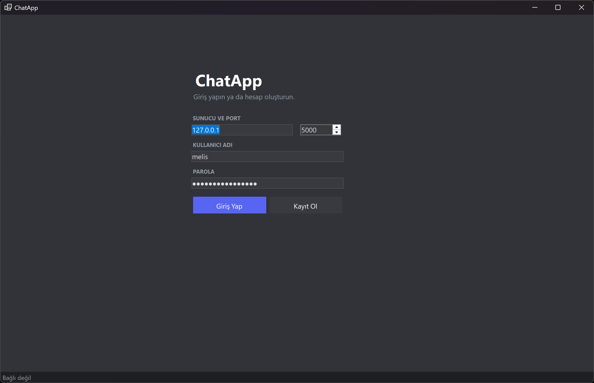
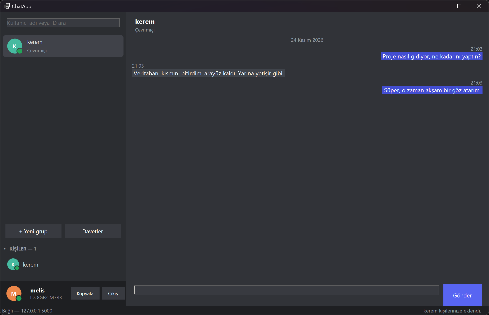
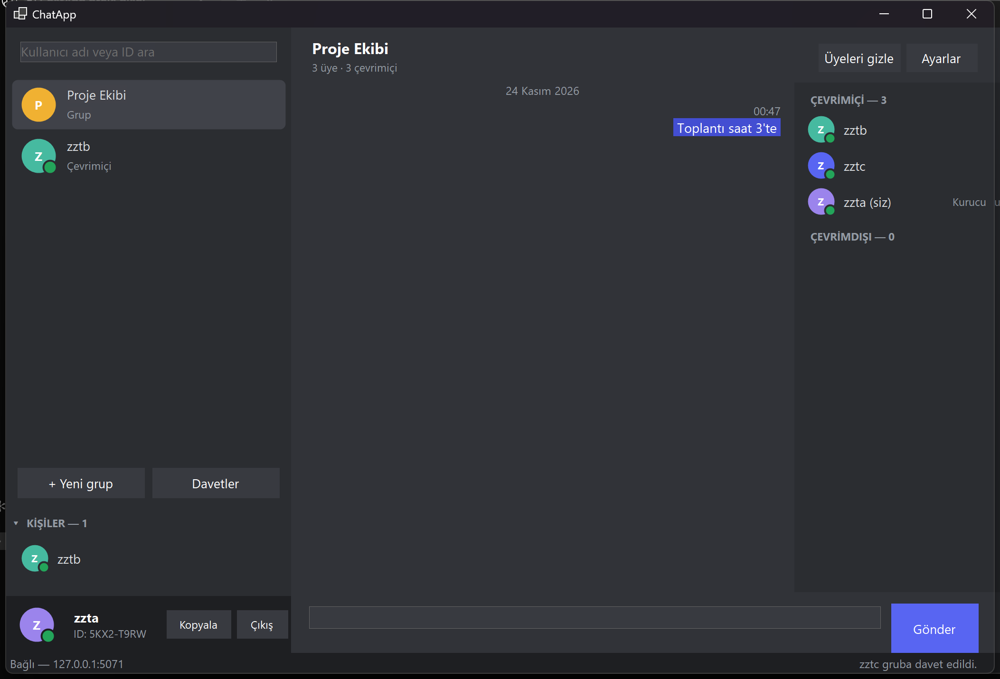
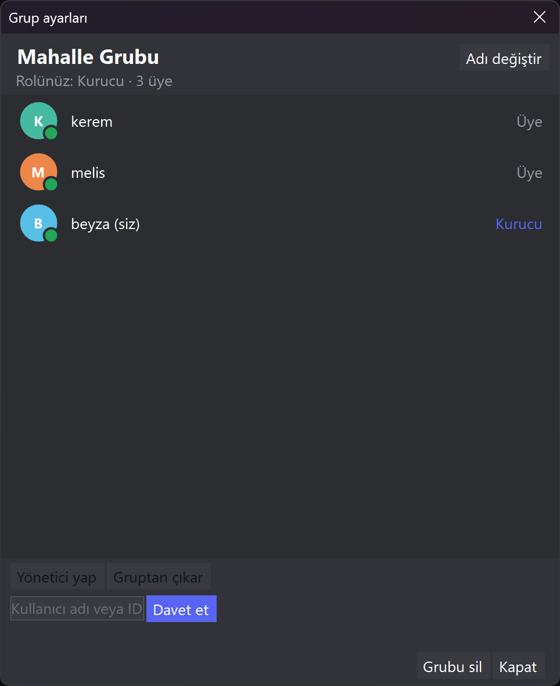

# ChatApp

C# / .NET 10 WinForms ile yazılmış istemci-sunucu sohbet uygulaması. Kullanıcılar hesap açar, kişilerini kullanıcı adı ya da ID ile ekler, birebir yazışır ve gruplar kurar. Karşı taraf çevrimdışıysa mesaj sunucuda bekler ve kullanıcı girince teslim edilir.

Ders ödevi olarak geliştirilmiştir. Gizlilik esastır: sunucu arayüzü ve günlükleri kullanıcı adı, grup adı, mesaj içeriği ya da parola göstermez, yalnızca hesap ID'lerini gösterir.

| Giriş | Özel sohbet |
|---|---|
|  |  |

| Grup ve üyeler paneli | Grup ayarları |
|---|---|
|  |  |

## Hızlı başlangıç

**Gereksinimler:**

- Windows 10/11
- [.NET 10 SDK](https://dotnet.microsoft.com/download)

```powershell
dotnet build ChatApp.slnx

# Sunucu (önce bunu başlatın)
dotnet run --project ChatServer

# İstemci (birden fazla kez çalıştırılabilir)
dotnet run --project ChatClient
```

1. Sunucu penceresinde portu (varsayılan **5000**) seçip **Başlat**'a basın.
2. İstemcide sunucu adresini ve portu girin. Aynı bilgisayarda deneme için `127.0.0.1`.
3. **Kayıt Ol** ile hesap açın, sonra giriş yapın.
4. Başka bir bilgisayardan bağlanılacaksa sunucu bilgisayarının güvenlik duvarında seçilen TCP portuna izin verin.

Sunucu verisi `%LocalAppData%\ChatApp\server\chat.db` (SQLite) dosyasındadır.

### Birim testleri

```powershell
dotnet test ChatShared.Test
```

Testler protokol, doğrulayıcılar, parola hash'i ve diğer saf mantığı kapsar. Arayüz ve sunucu ağ katmanı elle ve betikli uçtan uca senaryolarla doğrulanmıştır; kontrol listesi için bkz. [docs/ELLE_TEST_LISTESI.md](docs/ELLE_TEST_LISTESI.md).

## Özellikler

- **Hesaplar:** kullanıcı adı + parola ile kayıt ve giriş. Parolalar PBKDF2-SHA256 (600.000 yineleme) ile saklanır. Her hesaba sunucu benzersiz bir ID verir (`XXXX-XXXX`). Giriş denemeleri hız sınırına tabidir.
- **Kişiler:** kullanıcı adı ya da ID ile arama. Arama yalnızca tam eşleşme bulur; kısmi eşleşme yoktur. Bulunan kullanıcı onayla kişilere eklenir.
- **Özel sohbet:** birebir mesaj, çevrimdışı alıcı için sunucuda bekletme ve girişte teslim, okunmamış sohbetlerin belirgin gösterimi.
- **Gruplar:** kurma, davet (çevrimdışı kullanıcıya da), davet kabul/red, ad değiştirme, üye çıkarma, gruptan ayrılma, grubu silme. Üç sabit rol: **Kurucu**, **Yönetici**, **Üye**. Çevrimdışı üyelerin grup mesajları da girişte teslim edilir.
- **Çevrimiçi durum:** yalnızca kişileriniz ve ortak grup üyeleriniz birbirinin durumunu görür.
- **Arayüz:** koyu, Discord benzeri tema. Sol panelde başlatılmış sohbetler (son mesaja göre sıralı), arama ve "Kişiler" kartı; sağda seçili sohbet. Kendi mesajlarınız sağda, diğerleri solda. Grup sohbetinde açılıp kapanan üyeler paneli (çevrimiçi / çevrimdışı).
- **Ekran uyumu:** PerMonitorV2 DPI desteği. %100–%200 ölçek ve 1280×720 ile 3200×2000 arasındaki çözünürlüklerde denendi. Pencere dar olunca üyeler paneli kendiliğinden gizlenir.
- **Yerel geçmiş:** istemci her sohbeti `Belgelerim\ChatApp\History\<kullanıcı>\sohbetler\` altında ayrı bir dosyada tutar.
- **Sunucu izleme:** bağlı istemcileri ID ile listeler, olayları ID'lerle günlüğe yazar.

## Kullanım ipuçları

- Kullanıcı adı 3–20, parola 8–64 karakterdir; grup adı en çok 30, mesaj en çok 500 karakterdir.
- Birini eklemek için arama kutusuna **tam kullanıcı adını ya da ID'sini** yazın; çıkan sonuca tıklayıp onaylayın. Kendi ID'nizi profil şeridindeki **Kopyala** düğmesiyle paylaşabilirsiniz.
- Grup ayarları için grup adına sağ tıklayın ya da başlıktaki **Ayarlar**'ı kullanın.
- Parola unutulursa sıfırlama yoktur.

## Kullanılan teknolojiler

| Alan | Teknoloji |
|---|---|
| Dil ve platform | C# (nullable açık), **.NET 10** (`net10.0` / `net10.0-windows`) |
| Arayüz | **Windows Forms**: kod ile kurulan arayüz, `RichTextBox` mesaj görünümü, sahip-çizimli (`OwnerDraw`) listeler, PerMonitorV2 DPI |
| Ağ | `System.Net.Sockets` (`TcpListener` / `TcpClient`): düz TCP üzerinde satır tabanlı JSON protokolü |
| Serileştirme | `System.Text.Json` |
| Eşzamanlılık | `async`/`await`, `CancellationToken`, `System.Collections.Concurrent` |
| Parola ve kimlik | `System.Security.Cryptography`: PBKDF2-SHA256 (`Rfc2898DeriveBytes`), rastgele tuz, sabit zamanlı karşılaştırma; ID üretiminde kriptografik rastgele sayı |
| Sunucu verisi | **SQLite** (`STRICT` tablolar, WAL kipi, `user_version` ile şema göçleri) |
| İstemci geçmişi | Sohbet başına JSON Lines (`.jsonl`) dosyası + okunma zamanı için `state.json` |
| Pencere teması | Win32 `DwmSetWindowAttribute` (koyu başlık çubuğu) |
| Test | **xUnit** |

### NuGet paketleri

| Proje | Paket | Sürüm | Amaç |
|---|---|---|---|
| `ChatServer` | `Microsoft.Data.Sqlite` | 11.0.0 | SQLite erişimi (ADO.NET) |
| `ChatShared.Test` | `xunit` | 2.9.3 | Birim test çatısı |
| `ChatShared.Test` | `xunit.runner.visualstudio` | 3.1.4 | Visual Studio / `dotnet test` çalıştırıcısı |
| `ChatShared.Test` | `Microsoft.NET.Test.Sdk` | 17.14.1 | Test ana bilgisayarı |
| `ChatShared.Test` | `coverlet.collector` | 6.0.4 | Kod kapsamı ölçümü |

`Microsoft.Data.Sqlite` yerel SQLite kütüphanesini `SQLitePCLRaw.bundle_e_sqlite3` aracılığıyla getirir (ek kurulum gerekmez). `ChatShared` ve `ChatClient` hiçbir harici NuGet paketi kullanmaz; yalnızca .NET'in kendi kitaplıkları kullanılır.

## Proje yapısı

| Klasör | İçerik |
|---|---|
| `ChatShared` | Protokol (satır tabanlı JSON), mesaj türleri, doğrulayıcılar, hız sınırlayıcı, parola hash'i |
| `ChatServer` | Sunucu çekirdeği (oturumlar, yönlendirme, SQLite depolama) ve WinForms izleme penceresi |
| `ChatClient` | WinForms istemci |
| `ChatShared.Test` | xUnit birim testleri |
| `docs` | Elle test listesi, ekran görüntüleri |

## Bilinen sınırlamalar

- **Trafik şifresiz.** İstemci ile sunucu arasındaki bağlantı düz TCP'dir; parola ve mesajlar ağda korunmaz. Yalnızca güvendiğiniz ağda (ör. yerel ağ) kullanın. TLS planlanmıştır.
- **Uçtan uca şifreleme yok.** Çevrimdışı kullanıcı için bekleyen mesajlar sunucuda düz metin olarak saklanır; sunucuyu çalıştıran kişi veritabanını okuyabilir.
- **Parola sıfırlama yok.** Unutulan parola kurtarılamaz.
- **Sabit roller.** Kurucu / Yönetici / Üye dışında özel rol ya da yetki tanımlanamaz.
- **Güvenlik duvarı.** Sunucu başka bir bilgisayardan erişilecekse Windows güvenlik duvarında port açılmalıdır.
- **Tek sunucu, varsayılan port 5000.** Başka bir uygulama portu kullanıyorsa sunucu başlatılamaz; farklı port seçin.
- **Geçmiş yalnızca yerel.** Sohbet geçmişi o bilgisayarda tutulur; başka bir bilgisayarda aynı hesapla girilirse eski mesajlar görünmez (çevrimdışıyken gelenler hariç).
- **Eski geçmiş kullanılmıyor.** Önceki sürümün günlük `.txt` geçmiş dosyaları artık okunmaz; diskte olduğu gibi kalır.
- **Genel (herkese açık) sohbet yoktur.** Yazışma yalnızca kişiler ve gruplar arasındadır.
- **Sınırlar:** en çok 200 kişi, kullanıcı başına en çok 20 grup, grup başına en çok 50 üye; mesaj gönderimi ve giriş denemeleri hız sınırlıdır.
- Arayüz yalnızca Türkçedir ve Windows'a özgüdür.

## Gelecek çalışmalar

- **TLS:** bağlantıyı şifrelemek, sertifika parmak izi doğrulaması.
- **Uçtan uca şifreleme:** önce özel sohbetlerde (ECDH + AES-GCM, güvenlik kodu karşılaştırma), sonra gruplarda (grup anahtarı dağıtımı ve yenileme).
- **Arayüzsüz sunucu servisi:** ayar dosyasıyla çalışan, ileride buluta taşınabilir sunucu.
- **Özel roller:** isim ve serbest yetki seçimi.
- **Yükleyici:** istemci için kurulabilir paket.
