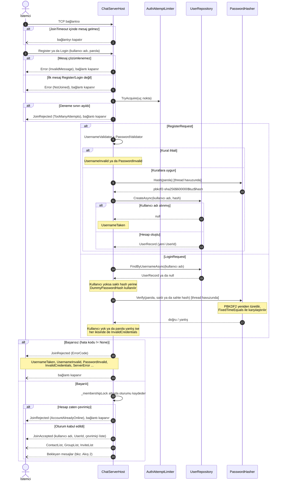
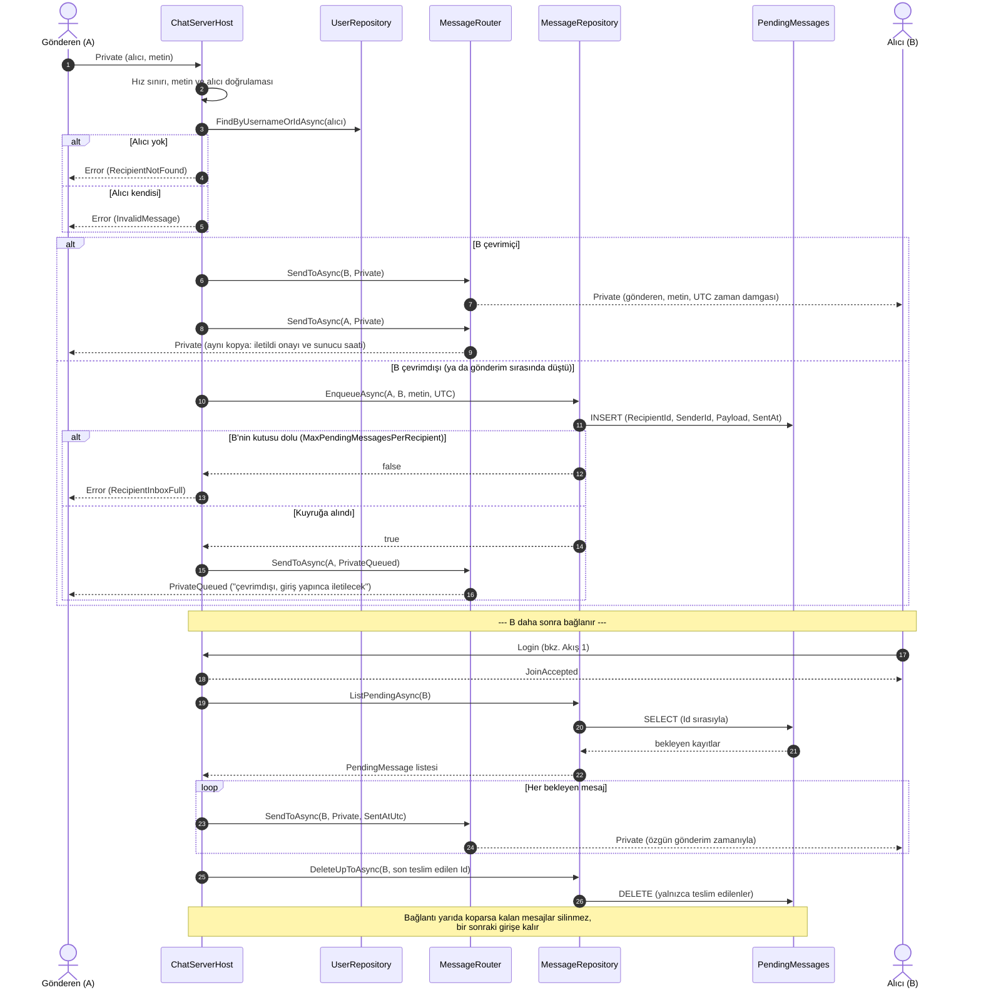
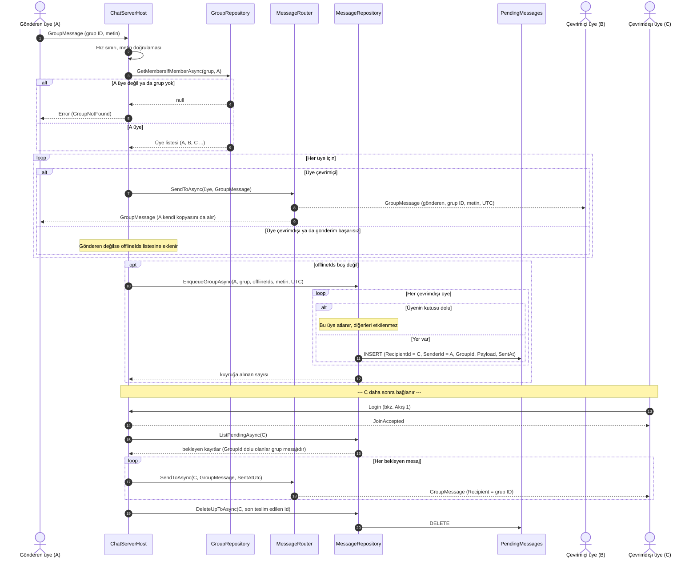

# Mimari

Bu belge sunucunun üç temel akışını [Mermaid](https://mermaid.js.org/) sıra diyagramlarıyla gösterir. İstemci ile sunucu arasındaki her mesaj, TCP üzerinde satır başına bir JSON nesnesi olarak (`ChatMessage`) iletilir; mesaj türü `MessageType`, hata nedeni `ErrorCode` alanındadır. Sunucu hazır hata metni göndermez, Türkçe açıklamayı istemci üretir.

İlgili kodlar: `ChatServer/ChatServerHost*.cs`, `ChatServer/Storage/*Repository.cs`, `ChatShared/PasswordHasher.cs`.

## 1. Kayıt / giriş el sıkışması

Bağlantıdan sonra ilk mesaj, süre sınırı (`JoinTimeout`) içinde gelen geçerli bir `Register` ya da `Login` olmalıdır; aksi halde bağlantı kapatılır. Kayıt ve giriş denemeleri bağlantı adresi başına hız sınırına (`AuthAttemptLimiter`) tabidir.

Zamanlama saldırısı koruması iki parçadır:

- Kullanıcı adı kayıtlı olmasa bile sahte bir hash (`DummyPasswordHash`) ile gerçek bir PBKDF2 doğrulaması yapılır; yanıt süresine bakarak hangi kullanıcı adlarının var olduğu anlaşılamaz.
- Hash karşılaştırması `CryptographicOperations.FixedTimeEquals` ile sabit sürede yapılır.

Ayrıca kullanıcı adı yanlış da olsa parola yanlış da olsa istemciye aynı hata (`InvalidCredentials`) döner. Parola hiçbir zaman günlüğe yazılmaz.

## 2. Özel mesaj teslimatı

Alıcı kullanıcı adı ya da ID ile verilebilir. Çevrimiçi alıcıya mesaj doğrudan iletilir ve veritabanına yazılmaz. Alıcı çevrimdışıysa (ya da gönderim sırasında düştüyse) mesaj `PendingMessages` tablosuna eklenir ve alıcı bir sonraki girişinde teslim edilir. Mesaj içeriği sunucu günlüğüne yazılmaz.

## 3. Grup mesaj yayını

Üye olmayan kullanıcının mesajı `GroupNotFound` ile reddedilir (grupların varlığı sızmasın diye "yok" ile "üye değil" ayırt edilmez). Mesaj her üyeye ayrı ayrı denenir; çevrimiçi üyelere anında iletilir, teslim edilemeyen çevrimdışı üyeler için tek seferde üye başına bir satır kuyruğa yazılır. Gönderenin kendisi kuyruğa alınmaz; çevrimiçi olduğu için kendi kopyasını da yayından alır.

